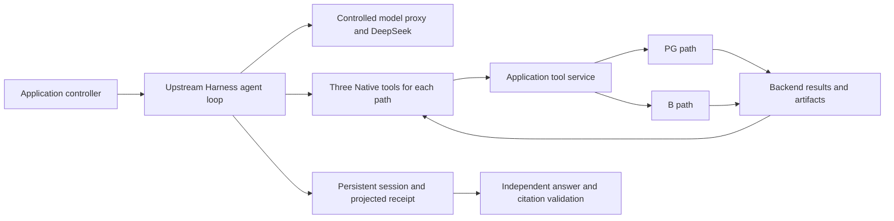

# Native Harness Execution with Independently Verified Evidence

This document describes a controlled integration between an upstream agent Harness, a DeepSeek model, and the repository's live demo adapter. The Harness runs the native agent loop. The model chooses when to call the available tools and produces the final answer. The adapter limits the model's tools and network access, preserves the session, and records enough evidence for an application controller to verify the result independently.

The integration does not replace the Harness loop with a scripted sequence. It also does not treat a successful tool call or a well-formed model response as proof that the business answer is correct.

## Component responsibilities



The upstream Harness owns the agent lifecycle, model conversation, Native tool dispatch, event stream, and session persistence. The integration pins [DeepSeek Harness](https://github.com/deepseek-ai/deepseek-harness) to commit `99f6f02fecdb7dff40c3fbc9470f5907c29f74ca` and rejects a checkout at a different commit or with local changes. A reproducible run must build the required packages from that exact revision.

DeepSeek supplies the agent's decisions and final text. The current adapter requests `deepseek-v4-flash` with thinking disabled, a 2,048-token output limit, streaming responses, and reported usage. The model receives a bounded task prompt, the results of tools it actually called, and no provider credential. A controlled proxy holds the provider credential, checks request ownership and budget before dispatch, disables automatic retries and provider fallback, and records request usage.

The repository adapter registers the permitted tools, adds the answer contract to the agent's system prompt, constrains model traffic to the controlled proxy, derives the execution phase from persisted Harness events, and projects a receipt from those events. The application controller owns the experiment inputs, invokes the adapter, performs the backend operations requested through the tools, and makes the final business decision.

## Two execution paths

The PG path uses Cortrix for embedding generation and PostgreSQL for durable document storage and vector retrieval. It applies the current document filter in the database and may use one bounded application model request for query planning, lexical recall, fusion, and reranking. That application request belongs to the same controlled session and budget as the surrounding Harness run.

The B path sends ingestion and query operations through the Cortrix HTTP API. Cortrix performs ingestion, processing, and retrieval. The application still owns its current-version selection rule and the independent validation of the model's final answer.

Both paths begin with a separate empty data location. Ingestion writes the approved documents to the actual backend. Querying waits for real backend readiness and returns the backend's observed ranking. Neither path substitutes a fixture, cached answer, or precomputed business decision for those operations.

## Native tool contract

Each path exposes exactly three Native tools to the agent:

| Operation | PG tool | B tool | Responsibility |
| --- | --- | --- | --- |
| Ingest | `pg_ingest_documents` | `cortrix_ingest_documents` | Write every approved input document and return a durable write receipt. |
| Status | `pg_get_status` | `cortrix_get_status` | Read the backend's actual ingestion and processing state when an additional readiness check is needed. |
| Query | `pg_query_evidence` | `cortrix_query_evidence` | Run the frozen business question against the ready backend and return bounded evidence. |

All three tools accept an empty object at the agent boundary. The adapter rejects extra arguments. For ingestion, it inserts the approved input identifiers. For status, it sends an empty argument object. For query, it inserts the original frozen question byte for byte. The model cannot rewrite, trim, translate, or append to the question, and the service verifies that the received question matches the run contract.

The tool service performs the operation and returns JSON. The adapter only forwards that result and records it as a Native tool result. A successful ingestion projection includes the operation, readiness state, document and chunk counts, an input manifest hash, and an artifact reference. A successful query projection includes the operation, status, result count, limit, truncation state, an artifact reference, and a bounded evidence array. Each evidence item contains its rank, citation reference, document identifier, version, lifecycle state, content, and content truncation state.

The projection deliberately omits the backend's `selected_field` and `resolver`. The agent must select an answer from the visible evidence. Full backend responses and operational telemetry remain in artifacts for independent verification.

## Final answer and independent validation

The final model response must be one JSON object with exactly these keys:

```json
{
  "selected_field": null,
  "document_id": null,
  "evidence_ref": null
}
```

On success, all three values are nonempty strings. The agent must choose one evidence item whose lifecycle state is `current`, infer the field from content that directly supports it, and copy the document identifier and citation reference from that same item. If the evidence is insufficient or a tool fails, the all-null object is the only permitted abstention. Markdown, explanations, additional keys, duplicate keys, unsupported fields, and invented citations are invalid.

JSON mode is enabled only for the final request, after persisted tool calls and successful tool results prove that ingestion and query completed in the same session. JSON mode constrains syntax; it does not establish correctness.

The projected Harness receipt therefore records the native completion state and marks the business result as requiring service verification. The application controller separately parses the raw final text and checks the exact key set, value types, selected evidence item, `current` lifecycle state, citation identity, content support, and agreement with the backend resolver. Only that second check can produce a passing business verdict.

## Session persistence and exact resume

The Harness persists its native transcript under `<runtime-directory>/<run-id>/<path>/`. The adapter keeps a driver state beside it with the session identifier, a hash of the input contract, request reservations, the latest phase proof, and any pause reason. The projected receipt contains model usage, Native tool calls and results, the final assistant text, and the stop reason.

Before every model step, the adapter clears any cached phase proof, flushes the Harness session, and reads the persisted events from the beginning. It pairs Native tool calls with successful results by session, run, path, call identifier, order, operation, and artifact reference. Only a successful ingest result followed by a successful query result can move the next request into the final answer phase. Events from another session, inherited history outside the session boundary, unmatched calls, failed results, and model narration do not satisfy the gate.

A paused run can resume only from the original runtime directory and exact session identifier. The input identifiers, frozen question, path, model, adapter contract, and pinned Harness commit must still match the stored contract hash. Resume uses the Harness's native session resume operation and retains the existing backend. It must not repeat an ingestion that already has a successful durable receipt or create a replacement session to replay the run.

## Request accounting and cost controls

The current adapter allows at most four model requests in one Harness session, including the final answer. The server remains authoritative for the aggregate request and cost limits and checks them before every paid dispatch. A bounded PG application model request counts against the same session and aggregate limits.

Every outbound model request is reserved before dispatch. A server response can remove that reservation from the request count only when it explicitly states that the request was paused before provider dispatch. Transport failures and other HTTP errors may already have incurred a charge, so their reservations remain until they are reconciled. Increasing a dollar budget does not bypass a session request limit.

Usage accounting keeps uncached input tokens, cache read tokens, and output tokens separate. Costs incurred by backend services are not necessarily present in the Harness session usage, so the server ledger must merge provider usage from the Harness, application assistance, and any Cortrix processing that contributes to the run. Published reports should distinguish an estimate based on published prices from an actual provider bill and should not present an estimate as a settled charge.

## Reproducibility and publication boundary

The pinned upstream Harness commit is necessary but not sufficient for reproduction. [`packages/live_demo`](../packages/live_demo/README.md) provides the adapter, tool service, backend contracts, schemas, support files, and offline verification procedure. A live operator must also supply a matching Cortrix RC2 image, the pinned Harness checkout and its built dependencies, an isolated runtime configuration, and a provider credential through the deployment environment. The repository does not discover or embed credentials.

In-memory fixtures can test tool restrictions, frozen question forwarding, persisted phase derivation, request body hashing, JSON mode placement, receipt projection, request limits, resume behavior, and redaction. They cannot prove provider compatibility or business correctness. Those claims require a fresh run against the documented backend and independent validation of the retained artifacts.

This document describes the implementation candidate and its execution contract. It does not publish a live result, claim that the integration is available in a Cortrix release, or establish deployment or evidence acceptance.
