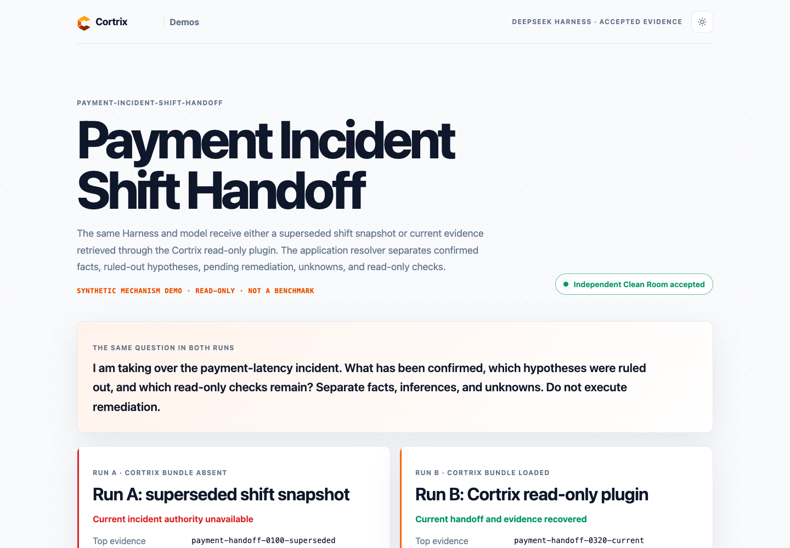

# Operational Continuity Clean Room Evidence

This record covers the accepted Payment Incident Shift Handoff and Migration Decision Recovery synthetic mechanism demos. It records the commands, result identities, bounded provider usage, accepted archive checks, and browser evidence produced in a fresh local clone. It does not claim benchmark quality or general model superiority.

## 1. Safe discovery before external work

The Clean Room started with repository discovery and static validation:

```bash
./democtl describe --scenario payment-incident-shift-handoff --json
./democtl validate --scenario payment-incident-shift-handoff
./democtl describe --scenario migration-decision-recovery --json
./democtl validate --scenario migration-decision-recovery
make validate
```

Observed result:

```text
payment-incident-shift-handoff: pass, external_calls=0
migration-decision-recovery: pass, external_calls=0
tests: 131 passed
public safety: pass
```

The pinned Harness, plugin, Cortrix source, Cortrix image revision, and four BGE model checksums matched before the campaign. The run reused an already validated disposable Harness build, Cortrix image, shared PostgreSQL volume, and model cache. Downloads and builds were both zero.

## 2. Live campaign command

The successful campaign was launched once with environment secret variables explicitly unset. The runner resolved the protected user-level profile only during the paid preflight and recorded `default_profile`, never a secret value or profile path.

```bash
env -u DEEPSEEK_API_KEY -u DEEPSEEK_BASE_URL -u CORTRIX_LLM_SECRET_FILE \
  ./democtl harness campaign \
  --campaign-contract runtime/harness/campaigns/operational-continuity.json \
  --harness-root .runtime/deepseek-harness-build \
  --plugin-root .runtime/cortrix-integrations/integrations/deepseek-harness \
  --cortrix-root .runtime/cortrix-harness-src \
  --pricing-snapshot .runs/pricing-snapshot.json
```

The campaign produced these accepted identities:

| Scenario | Run ID | Clean Room review | Run A top evidence | Run B top evidence |
| --- | --- | --- | --- | --- |
| Payment Incident Shift Handoff | `payment-incident-shift-handoff-20260819T080134Z` | `REVIEW-PAYMENT-INCIDENT-HANDOFF-20260819T080556Z` | `payment-handoff-0100-superseded` | `payment-handoff-0320-current` |
| Migration Decision Recovery | `migration-decision-recovery-20260819T080134Z` | `REVIEW-MIGRATION-DECISION-RECOVERY-20260819T080556Z` | `option-b-recommendation-superseded` | `final-decision-option-c-current` |

Payment Run A preserved the expected negative control with `authority_pass=false`; Run B returned the current incident handoff with `authority_pass=true`. Migration Run A preserved the superseded option B recommendation in all three event-position variants. Migration Run B recovered option C and the still-valid constraints with `authority_pass=true` for the front, middle, and end variants.

## 3. Provider and cost evidence

The two scenarios shared one reviewed campaign envelope. The same campaign totals are bound into both accepted manifests:

```text
provider/model: deepseek/deepseek-v4-flash
observable_calls: 9
observable_input_tokens: 46200
observable_output_tokens: 3337
observable_cache_hit_tokens: 0
observable_cost_usd: 0.00740236
reviewed_bound_usd: 0.15139936
campaign_budget_usd: 5.00
usage_visibility: partial
local_generative_llm: false
fallback_used: false
```

Because provider visibility is partial, the observable amount is not presented as a complete billing total. It is evidence that the reviewed upper bound remained below the campaign budget.

## 4. Accepted archive verification

After independent Clean Room review and local evidence promotion, the accepted archive was verified without external calls:

```bash
./democtl harness verify-accepted --scenario payment-incident-shift-handoff
./democtl harness verify-accepted --scenario migration-decision-recovery
```

Observed output:

```text
payment-incident-shift-handoff: status=pass, proof_scope=archive_integrity, live_reexecution=false, screenshots=3, external_calls=0
migration-decision-recovery: status=pass, proof_scope=archive_integrity, live_reexecution=false, screenshots=3, external_calls=0
```

The archive verification checks tracked pointers, manifests, checksums, source identity, assertions, cleanup receipts, Clean Room review records, and screenshot bindings. It does not make another LLM call.

## 5. Browser evidence

The accepted viewer was served locally with the accepted-only gate. The public record uses the equivalent loopback command so it does not publish a workstation network address:

```bash
python3.14 packages/viewer/serve.py --bind 127.0.0.1 --port 18765 --harness-scenario payment-incident-shift-handoff
python3.14 packages/viewer/serve.py --bind 127.0.0.1 --port 18765 --harness-scenario migration-decision-recovery
```

Every requested HTML, script, stylesheet, logo, manifest, evidence, resolver, cleanup, locale, profile, and position-variant resource returned HTTP 200. The final captures used an isolated headless Chrome profile with extensions disabled. The screenshots were then bound to specific accepted evidence files with `./democtl harness record-screenshot`.

### Payment Incident Shift Handoff



- [Desktop, 1440 by 1000](../scenarios/payment-incident-shift-handoff/evidence/runs/payment-incident-shift-handoff-20260819T080134Z/screenshots/payment-incident-shift-handoff-desktop.png), SHA-256 `31a0e7887afc57d9dee07ae3c04f6dafb66736d3e26fa8a1c7537e22c94e6fd3`
- [Complete result page, 1200 by 3600](../scenarios/payment-incident-shift-handoff/evidence/runs/payment-incident-shift-handoff-20260819T080134Z/screenshots/payment-incident-shift-handoff-full-page.png), SHA-256 `34208c0a76f522a0953458e43eef213044cc8adbf0172e9486043b4f302a65e7`
- [Narrow viewport, 800 by 1100](../scenarios/payment-incident-shift-handoff/evidence/runs/payment-incident-shift-handoff-20260819T080134Z/screenshots/payment-incident-shift-handoff-mobile.png), SHA-256 `20d8a1e1016e8c7a7fbb33e383b307da6a3a357dd424e18942a017ad03a1cc1a`

### Migration Decision Recovery


- [Desktop, 1440 by 1000](../scenarios/migration-decision-recovery/evidence/runs/migration-decision-recovery-20260819T080134Z/screenshots/migration-decision-recovery-desktop.png), SHA-256 `bfaa90d690f54f8ff567c619ff634906b0906a2a76a3bfb1405f044519946bdc`
- [Complete result page, 1200 by 4000](../scenarios/migration-decision-recovery/evidence/runs/migration-decision-recovery-20260819T080134Z/screenshots/migration-decision-recovery-full-page.png), SHA-256 `97c5fb33d82196b99b2994aeb03662e4217ee7d7e4f88728a662f8ecf15ba3b2`
- [Narrow viewport, 800 by 1100](../scenarios/migration-decision-recovery/evidence/runs/migration-decision-recovery-20260819T080134Z/screenshots/migration-decision-recovery-mobile.png), SHA-256 `a66977c13189ea785a9129e6afd29b92aef4a0078b405c831e3bec4f34cfa12e`

## 6. Cleanup and publication boundary

Both accepted manifests report namespace cleanup, containers absent, and no runtime secret materialized. The final listener and one-time Chrome profiles were removed, while the reusable model cache and validated data volume were preserved. No remote Git command, PR, release, or publication action was performed as part of this record.
