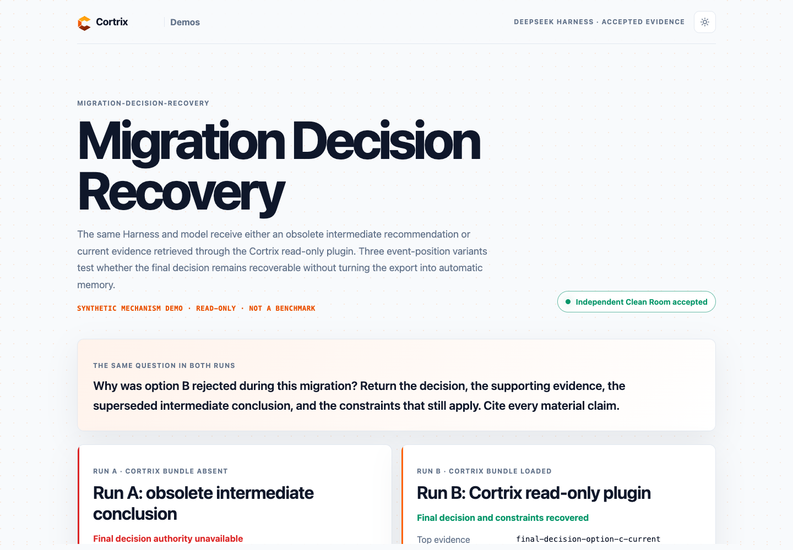

# Migration Decision Recovery

This synthetic mechanism demo asks whether an Agent can recover the final decision from a long migration task after an earlier option B recommendation was superseded.

The frozen question is:

> Why was option B rejected during this migration? Return the decision, the supporting evidence, the superseded intermediate conclusion, and the constraints that still apply. Cite every material claim.

Run A and Run B use the same pinned DeepSeek Harness commit, `deepseek/deepseek-v4-flash`, question, answer contract, fixture corpus, non-Cortrix tools, limits, and application resolver. The only independent variable within each comparison is whether the read-only Cortrix bundle supplies evidence.

- [Run A explanation](docs/run-a-intermediate-conclusion.md)
- [Run A manual Runbook](docs/run-a-intermediate-conclusion-step-by-step.md)
- [Run B explanation](docs/run-b-cortrix-plugin.md)
- [Run B manual Runbook](docs/run-b-cortrix-plugin-step-by-step.md)
- [Clean Room command, cost, and screenshot evidence](../../docs/operational-continuity-clean-room-evidence.md)

The campaign runs `front`, `middle`, and `end` variants. Each contains the same 30 event identities; only the position of the final-decision event changes. Every variant must pass Run A, Run B, the resolver, serial-query, and cleanup gates. The explicit event export is application-owned, synthetic, hashed input, not automatic Cortrix memory.

Agent discovery starts with `agent.json`, then `./democtl describe --scenario migration-decision-recovery --json` and `./democtl validate --scenario migration-decision-recovery`. The accepted run is `migration-decision-recovery-20260819T080134Z`; verify it with `./democtl harness verify-accepted --scenario migration-decision-recovery` and view it with `make viewer-harness SCENARIO=migration-decision-recovery`.

